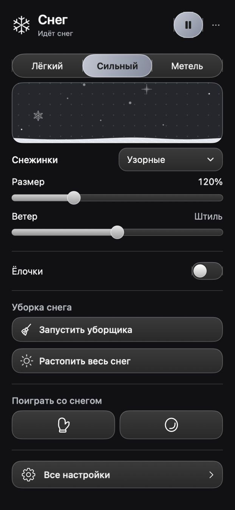
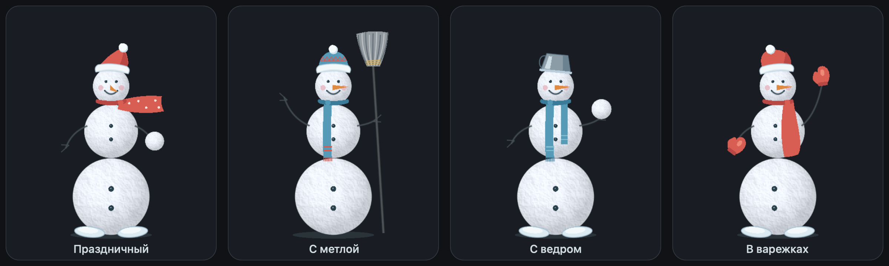

# Снег для macOS ❄️

Нативное приложение в строке меню: снег падает поверх рабочего стола, накапливается на окнах и превращается в сугробы, снежки и снеговиков.

**Swift · AppKit · SwiftUI · SpriteKit · Apple Silicon и Intel**

[English](../README.md) · [Установка и управление](../INSTALL.md)


На примере показана графика приложения на однотонном фоне. При обычной работе фон прозрачный — виден ваш рабочий стол.

## Возможности

- Накопление снега на окнах, внизу экрана и на Dock. Сугробы сохраняют бугорки, огибают углы и осыпаются с краёв.
- Простой и фактурный снег. Простые и узорные снежинки с настройкой размера, интенсивности и ветра.
- Варежка расталкивает снег и сталкивает его вниз с окон. В режиме игры можно поднимать снег, катать снежки и собирать четырёх разных снеговиков: праздничного, с метлой, с ведром и в варежках. Первый образ случайный, затем они сменяют друг друга по кругу.
- Брошенный снежок разбивается о воображаемое стекло монитора и оставляет тающий след с брызгами.
- Два трактора с вращающимися колёсами и ковшами. Ручная и автоматическая уборка.
- Три вида гирлянд под строкой меню с настройками яркости и мигания.
- Пять небольших векторных ёлочек с анимацией роста, мигающими звёздами и лампочками. Шесть расстановок по низу экрана сменяют друг друга при включении.
- Пауза, скрытие эффектов и поддержка системного уменьшения движения.

Новый графитовый интерфейс включает компактную панель и девять вкладок настроек. Выбор варежки или снежка запускает игру. Повторное нажатие на выбранный инструмент или **Esc** завершает её. Лопата и удаление скрыты. В блоке «Уборка снега» доступны запуск уборщика и растапливание снега; выбор экранов находится в полных настройках.





Образ сохраняется при переносе готовой фигуры и смене материала снега. Разборка и повторная сборка дают следующий образ. Предпросмотр настроек не влияет на порядок появления.

Обычный режим пропускает клики в другие приложения. Настройки и файлы хранятся локально. Внешние пакеты, серверы и аналитика не используются.

## Язык интерфейса

Английский выбран по умолчанию независимо от языка macOS. Язык переключается в меню **…** компактной панели или внизу бокового меню настроек. Правый клик по снежинке открывает системное меню.

Меню, открытое окно настроек, статусы и подсказки меняют язык сразу. Выбор сохраняется после перезапуска. Снег, значения настроек и выбранный раздел остаются на месте; сброс настроек снега не меняет язык.

Новые возможности описаны в [изменениях версии 0.3.9](../CHANGES_0.3.9.md). Новый интерфейс — в [заметках 0.3.0](../CHANGES_0.3.0.md).

## Сборка

Нужен Mac с установленным Xcode и выбранными инструментами командной строки. Для тестов модели нужен Swift 5.9 или новее. Целевая система приложения — **macOS 12+**; сборка Universal включает **arm64 и x86_64**.

```sh
git clone https://github.com/Radion13/Snow-macOS.git
cd Snow-macOS
chmod +x scripts/*.sh
./scripts/build.sh Release
open build/Release/Snow.app
```

Можно также открыть `Snow.xcodeproj` в Xcode и запустить схему `Snow`. Приложение появится в строке меню. Для сборки из исходников платная учётная запись разработчика Apple не нужна: используется локальная ad-hoc подпись.

## Проверки и установщик

```sh
swift test
./scripts/validate.sh
./scripts/package.sh
```

`swift test` проверяет независимую модель `SnowCore`. Само приложение собирается через Xcode. Перед `validate.sh` завершите другие копии Снега: приложение допускает только один запущенный экземпляр. Нативные проверки требуют графического сеанса macOS и временно открывают тестовые окна.

Установщик создаётся в `build/Snow-0.3.9-universal.dmg`. Подпись Developer ID и нотариализация в этом проекте не настроены.

## Состав репозитория

- `Sources/SnowCore` — симуляция, геометрия снега, взаимодействия, настройки и расстановки ёлочек.
- `Sources/SnowApp` — меню, настройки, окна наложения, интеграция с macOS и графика.
- `Tests/SnowCoreTests` — проверки модели и исправленных ошибок.
- `Resources` и `scripts` — ресурсы, сборка, диагностика и упаковка DMG.
- `docs/images` — примеры отрисовки и векторная ёлочка, экспортированная из графических путей приложения.

Опубликован исходник **macOS 0.3.9, сборка 32**. Windows-версия и готовые установщики в этот репозиторий не входят. Прошли 117 тестов модели, 103 проверки возможностей и локализации, 12 проверок рисунков снеговиков и 20 проверок интерфейса — [подробности](VALIDATION.md), [проверка дизайна](design-qa.md). Сборка и проверки выполнялись на Apple Silicon; физический Intel и macOS 12 требуют отдельной проверки. Работа на нескольких дисплеях и геометрия Dock могут зависеть от версии macOS и конфигурации экранов.

В коде сохранены, но скрыты в интерфейсе: лопата и удаление, зимние сцены, снег на виджетах, иконки-примеры снежинок и изображение на ковше.
